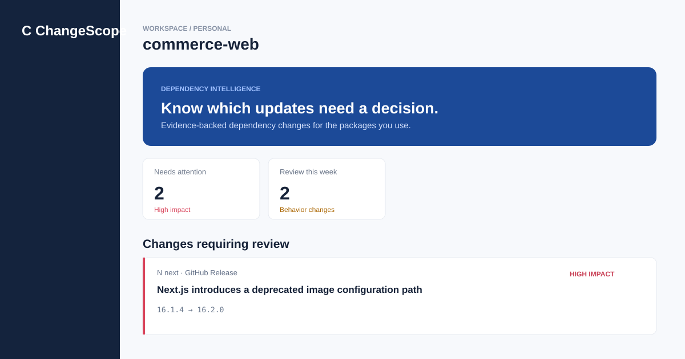

# ChangeScope

**Dependency changes, translated into decisions with evidence.**

ChangeScope is an interactive developer-tool prototype. A user imports a Node.js `package.json`; the application identifies relevant dependency changes, ranks their impact, surfaces the quoted source evidence, and turns important changes into a focused action plan.



## Demo capabilities

- Import any valid `package.json` from the browser.
- Match its dependencies against a deterministic change-event fixture.
- Filter high, medium, and low impact events.
- Inspect an evidence trail with source links and confidence values.
- Mark change cards as handled and maintain an action plan in browser storage.
- Export the action plan as Markdown.

The current MVP deliberately uses bundled fixture events so the demo is repeatable, works without credentials, and can be tested locally. The product architecture is designed to replace that fixture with GitHub Releases and npm Registry adapters in the next iteration.

## Run locally

Requires Node.js 20 or later.

```bash
npm test
npm run dev
```

Open [http://localhost:4173](http://localhost:4173).

## Engineering choices

- **No framework dependency for the demo:** a native ES-module frontend and Node server make the prototype portable and easy to audit.
- **Pure analysis module:** dependency matching and scoring inputs live in [`src/analyzer.js`](src/analyzer.js), with Node's built-in test runner covering its behavior.
- **Evidence-first UX:** each change card links the recommendation back to its source and the relevant quoted statement.
- **Explicit product limitation:** this release demonstrates an auditable decision workflow, not live package surveillance. It does not claim to ingest external data in real time.

## Next engineering iteration

1. Add a FastAPI service with PostgreSQL persistence for workspaces, sources, changes, and action items.
2. Add GitHub Releases and npm Registry adapters with retry, rate-limit handling, idempotent sync and event hashing.
3. Move long-running sync work into Redis-backed workers.
4. Add integration and browser end-to-end tests, Docker Compose, and CI.

## Project documents

- [Product definition](docs/PRD.md)
- [Architecture proposal](docs/ARCHITECTURE.md)
- [Implementation plan](docs/IMPLEMENTATION_PLAN.md)
